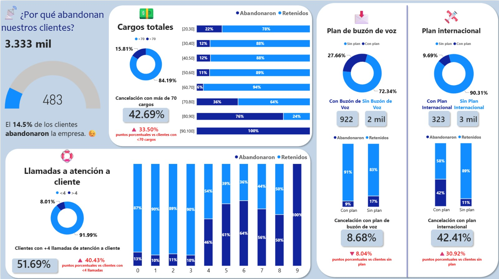
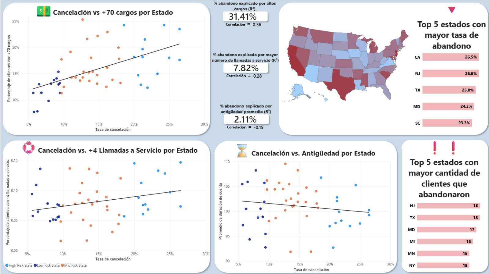

# Churn

Proyecto de análisis de datos enfocado en identificar patrones asociados a la cancelación de clientes (Customer Churn) mediante técnicas de análisis exploratorio, estadística inferencial y visualización de datos.

Se realiza un análisis de las características de los clientes, explorando su relación con la tasa de abandono y sus diferencias entre entidades geográficas. Se aplican pruebas estadísticas para evaluar asociaciones entre variables categóricas y diferencias en variables numéricas, complementando el análisis con un modelo de clasificación para predecir la cancelación de clientes.

El proyecto integra Python, SQL y Power BI para el procesamiento, análisis, modelado y visualización de los datos.

---
## Vista Previa del Dashboard




---

## Estructura del Repositorio

```text
├── data/              # Instrucciones o archivos CSV procesados
├── notebooks/         # Notebook para limpieza y modelado (.ipynb)
├── reports/           # Reporte de Power BI (.pbix) y capturas
├── docs/              # Documentación técnica (ej. DAX_MEASURES.md)
├── .gitignore         # Archivos excluidos del control de versiones
└── README.md          # Documentación principal del proyecto
```

---

## Metodología y Flujo de Trabajo

1. **Preprocesamiento de los datos(`sql/`):** 
    - Unión de `churn-bigml-80.csv`y `churn-bigml-80.csv`
    - Despivotar columnas para el análisis
2. **Procesamiento de Datos en Python (`notebooks/`):**
    - Lectura y estandarización de los archivos CSV originales.
    - Limpieza de datos (tratamiento de nulos, formateo de fechas y tipos de variables) usando `pandas`, `seaborn` y `matplotlib`.
    - Exportación de bases limpias / modelos (`.csv`).
    - Ajuste de modelos de Regresión Logística y Gradient Boosting.

3. **Modelado y Visualización en Power BI (`reports/`):**
    - Construcción del modelo de datos.
    - Creación de medidas DAX para métricas acumuladas, tasas y variaciones.

---

## Hallazgos e Insights Clave

- **Insight 1:** A partir de 70 cargos, los clientes abandonan más.
- **Insight 2:** A partir de las 4 llamadas a servicio a cliente, los clientes abandonan más.
- **Insight 3:** Los clientes con plan internacional son más propensos a abandonar.
- **Insight 4:** Los clientes sin buzón de voz son más propensos a abandnar.
- **Insight 5:** La cantidad de cargos está relacionada con las zonas.
---

## Cómo Ejecutar este Proyecto

### 1. Requisitos Previos
- **SQL**
- **Python 3.12.10** (con paquetes: `pandas`, `seaborn`, `matplotlib`, `numpy`, `imblearn`, `sklearn`, `scipy` y `math`)
- **Power BI Desktop**

### 2. Pasos para Clonar y Correr
1. Clonar el repositorio:
   ```bash
   git clone https://github.com/moinovoa/churn
   ```
2. Colocar los archivos CSV originales en la carpeta `data/`
3. Subir `churn-bigml-80.csv` y `churn-bigml-20.csv` a tu gestor de bases de datos.
4. Ejecutar `crear_tabla_unpivoted` y guardar en `data/` la primera tabla como `churn-bigml.csv`, y la segunda como `churn-bigml-unpivoted.csv`.
5. Ejecutar el notebook de python ubicado en `notebooks/python/`.
6. Abrir el archivo `.pbix` en `reports/` con Power BI Desktop.